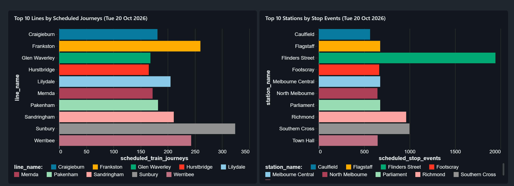
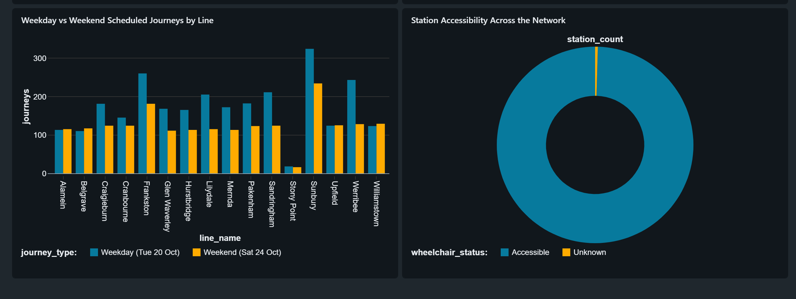

# Melbourne Public Transport Analytics

> **Status: work in progress.** This repository is being built as a portfolio project for a Data Analyst / BI Analyst pathway.

## Project overview

This project explores scheduled Melbourne metropolitan train services using Victorian GTFS timetable data. It demonstrates a Databricks workflow for preparing data with PySpark, creating Delta tables in Unity Catalog, publishing an AI/BI dashboard, and using Databricks Genie Code to answer business questions in natural language.

## Tools used

- Databricks (notebooks, Unity Catalog, Delta tables)
- PySpark
- SQL
- Databricks AI/BI Dashboards
- Databricks Genie Code (AI assistant for dashboard authoring and data Q&A)
- Power BI (planned)

## Current contents

- `notebooks/01_project_setup.ipynb` — reads GTFS source files from a Databricks Volume, creates raw and cleaned Delta tables, and calculates scheduled-service and accessibility measures.
- `docs/dashboard.md` — documentation of the published AI/BI dashboard: widgets, KPIs, the four business questions it answers, and methodology.
- `docs/genie-code-analysis.md` — how Genie Code was used to answer the business questions, including a worked example of iterating on the weekday/weekend methodology.
- `docs/Databricks_dashboard-1.png` and `docs/Databricks_dashboard-2.png` — screenshots of the published dashboard.

The notebook uses a Databricks Volume path configured in the workspace. It does not include raw GTFS data or any Databricks credentials.

## Work in progress

Reproducible setup instructions, a documented data source and licence, SQL-only query files, and a Power BI report are still to be added.

## Databricks dashboard

A published Databricks dashboard is available in the project workspace: [Open the dashboard](https://dbc-d0e3bc0b-bca5.cloud.databricks.com/dashboardsv3/01f1c91a3fc515a3bc61b7350c5c988c/published).

Access currently requires permission to the Databricks workspace, so it is not a public portfolio link. Full documentation of the dashboard — widgets, KPIs, business questions, and methodology — is in [docs/dashboard.md](docs/dashboard.md).

## Answering business questions with Genie Code

The dashboard's analysis was built with Databricks Genie Code: business questions asked in natural language, answered with SQL over the Unity Catalog tables, and published as dashboard visuals. [docs/genie-code-analysis.md](docs/genie-code-analysis.md) documents the workflow, the questions asked, and a worked example where reviewing the generated SQL led to a methodology correction (single-date versus full-window weekday/weekend averages).

## Dashboard screenshots

The screenshots below are saved from the project dashboard. They show scheduled-service measures for the dates displayed in the visuals; they should not be interpreted as live service information.

### Scheduled-service overview



### Weekday, weekend, and accessibility view



## Workflow status

1. Document the public dataset source and its licence — planned.
2. Make the Databricks setup reproducible for another user — planned.
3. Add SQL query files alongside the notebook workflow — planned.
4. Build a Power BI report from the prepared data — planned.
5. Explore how Databricks AI/BI Genie can help users ask natural-language questions of the prepared data, documenting the setup and limitations — **done** (see [docs/dashboard.md](docs/dashboard.md) and [docs/genie-code-analysis.md](docs/genie-code-analysis.md)).

## Repository structure

Current and planned folders:

```text
melbourne-public-transport-analytics/
├── data/           # Planned dataset notes; raw data is not committed unless licensing permits
├── notebooks/
│   └── 01_project_setup.ipynb
├── sql/            # SQL queries (to be added)
├── power-bi/       # Power BI files or report documentation (to be added)
├── docs/
│   ├── dashboard.md
│   ├── genie-code-analysis.md
│   ├── Databricks_dashboard-1.png
│   └── Databricks_dashboard-2.png
├── README.md
└── .gitignore
```

## How to follow the project

As the work progresses, this README will be updated with the data source, setup instructions, dashboard views, and documented insights.

## Author

Built as a learning and portfolio project.
